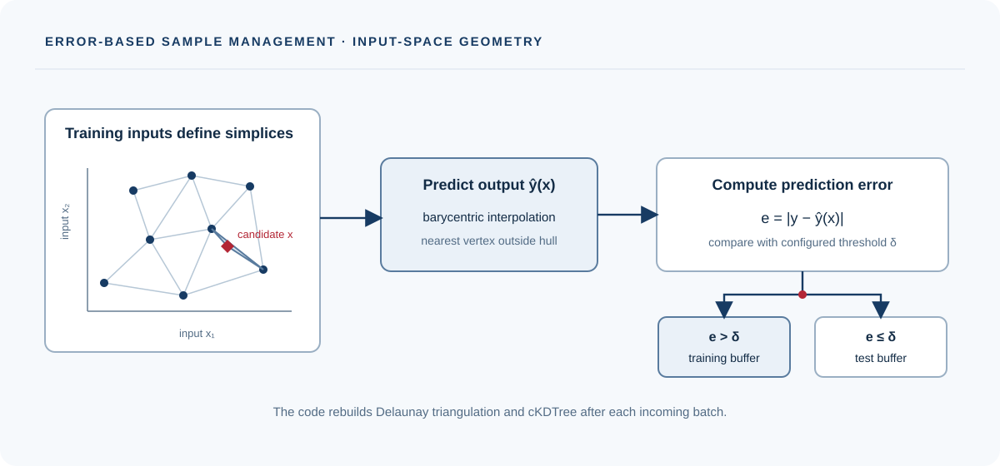

# Error Distribution Smoothing

[Project homepage](https://paoshou-china.github.io/Error-Distribution-Smoothing/) · [Quick start](#quick-start) · [Source](https://github.com/PaoShou-China/Error-Distribution-Smoothing)

This repository contains Error Distribution Smoothing (EDS) data-management code and experiment implementations for imbalanced regression and system identification. The included examples cover synthetic regression, Lorenz dynamics, polar moment of inertia, Cartpole and Quadcopter tasks. Experiment variants are maintained in separate directories.

## Method and code

The shared `src/eds.py` Manager predicts new outputs from the current training set. It uses barycentric interpolation inside the Delaunay convex hull and nearest-vertex prediction outside it. The absolute prediction error is compared with the configured threshold `delta`: values above the threshold enter the training buffer; the rest enter the test buffer. The triangulation and KDTree are rebuilt after each incoming batch.

The repository also includes SMOGN implementations and experiment-specific managers, processing scripts, datasets and plots. These scripts have their own input/output paths and may differ from the shared implementation.

## Installation

```bash
python -m venv .venv
source .venv/bin/activate
python -m pip install -r requirements.txt
```

On Windows PowerShell, activate with `.venv\\Scripts\\Activate.ps1`.

## Quick start

Run an experiment from its own directory. For example, the motivation example includes its processing script and data:

```bash
cd 1_Motivation_Example
python process.py
```

The shared implementation's root example is also available through `process.py`; inspect its configured paths and parameters before running. Scripts use relative paths, and some experiments expect data files to be present in their dataset folders.

## Repository map

- `src/eds.py`: shared single-output EDS Manager and data-processing example.
- `src/`: shared method and resampling implementations.
- `manager.py`, `process.py`: root multi-output data-management example.
- `1_Motivation_Example/`: synthetic motivation example.
- `2_Dynamics_System_Identification/`: Lorenz-system identification.
- `3_Polar_Moment_of_Inertia/`: synthetic image-feature regression.
- `4_Real_World_Experiment/4_1_Cartpole/`: Cartpole example.
- `4_Real_World_Experiment/4_2_Quadcopter/`: Quadcopter example.
- `experiments/`: additional experiment and plotting scripts.

The root-level multi-output Manager checks batch dimensions before updating and appends selected rows in batches. The shared single-target implementation is in `src/eds.py`; it preserves its own scalar-output error rule. These two implementations are kept separate because their output shapes and error metrics differ.

## Reproducibility

Run each script from its documented working directory and preserve its relative data paths. Dataset provenance, feature/label schemas, seeds and model settings vary across experiments; consult the corresponding files before comparing results.

## Citation

Use the final published bibliographic record from the repository's reference information when citing the method.
